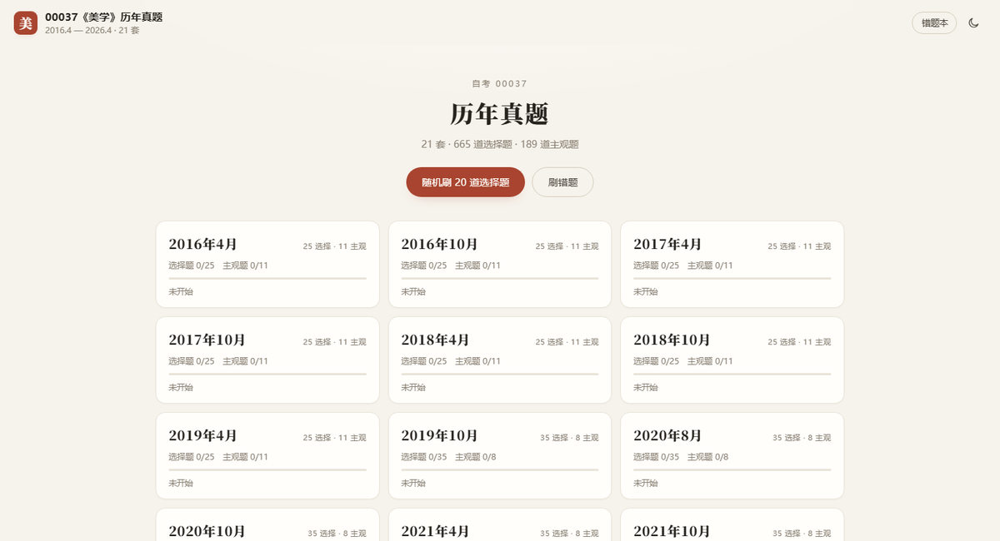
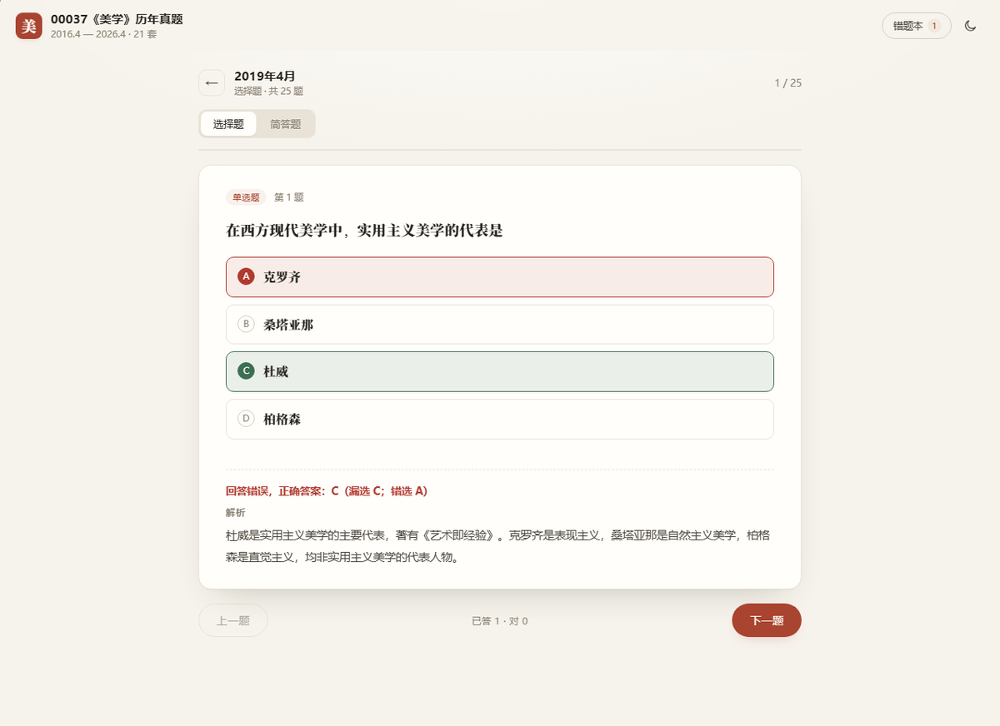

# 00037《美学》历年真题 · 在线刷题 + 5 套押题卷

自考 00037《美学》的真题刷题页与考前押题卷。题库来自 2016 年 4 月—2026 年 4 月共 **21 套**真题：**665 道选择题、189 道主观题**；另外按高频考点组了 **5 套押题卷（PDF，含答案详解）**。

<p align="center">
  
</p>

<p align="center">
  
</p>

## 网页：按考期刷题

- **按考期分组**：首页列出 2016—2026 的 21 套卷，每套标出选择题 / 主观题数量和完成进度。
- **选择题即时判分**：点选项立刻判断对错，标出正确答案，展开解析；多选题选完点「确认答案」。
- **主观题先想后看**：先回忆，再展开参考答案和解析，然后自评「会了 / 有点模糊 / 不会」。
- **错题本**：答错的选择题、自评模糊或不会的主观题自动进入错题本，可以集中重刷。
- **进度留存**：进度只写在浏览器 `localStorage`（键名 `meixue-exam-v1`），换设备不同步。
- **随机 20 题**：碎片时间快速过一遍。
- **深色模式、手机适配、键盘操作**。

### 快捷键

| 按键 | 作用 |
| --- | --- |
| `A`–`E` | 选择选项 |
| `Enter` | 单选直接判分 / 多选确认 / 下一题 |
| `空格` | 下一题；主观题展开参考答案 |
| `1` / `2` / `3` | 主观题自评：会了 / 模糊 / 不会 |
| `←` / `→` | 上一题 / 下一题 |
| `Esc` | 返回首页 |

## 押题卷：5 套 PDF

`pdf/` 目录下是 5 份 A4 打印版：

```
pdf/00037美学-押题卷一.pdf   （12 页）
pdf/00037美学-押题卷二.pdf   （12 页）
pdf/00037美学-押题卷三.pdf   （11 页）
pdf/00037美学-押题卷四.pdf   （11 页）
pdf/00037美学-押题卷五.pdf   （12 页）
```

**结构**：按 2019 年 10 月以来真题的卷面结构组卷 —— 单选 30 题（30 分）、多选 5 题（10 分）、简答 6 题（30 分）、论述 1 题（10 分）、案例分析 1 题（20 分），满分 100 分。

**组卷方式**：

1. 把 21 套真题的每道题按关键词归到 58 个考点上（见 `scripts/points.py`）；
2. 统计每个考点出现过的考期数，作为「高频」排序依据；
3. 每套卷优先覆盖高频考点，同一考点的题在 5 套卷之间轮流使用，卷内不重复考点、跨卷不重复题；
4. 每章题量设上限，避免整卷集中在某一章。

**答案与解析**：全部取自原卷答案与解析，未改写题干和选项（因此解析里提到的「选项 A/B/C/D」与卷面一致）。每份 PDF 都带选择题答案速查表、逐题解析和主观题参考答案。

**使用建议（考前 2 天）**：

- 第 1 天：卷（一）（二），闭卷限时 150 分钟，对答案后把错题考点回教材背一遍；
- 第 2 天：卷（三）（四），重点看主观题的答题层次；
- 考前晚上：卷（五）+ 五套卷的选择题错题速览。

> 押题卷是按历年高频考点重组的练习题，不是官方试题，也不承诺命中；答案与解析以原卷为准。

## 目录结构

```
meixue-exam/
├── index.html                 # 刷题页
├── assets/
│   ├── style.css              # 样式（含深色模式、手机适配）
│   ├── app.js                 # 判分、错题本、进度、目录
│   └── icon.svg
├── data/
│   ├── exam.js                # 题库（页面实际加载）
│   ├── papers.json            # 同一份题库的 JSON
│   ├── mock.json              # 5 套押题卷数据
├── pdf/
│   ├── 00037美学-押题卷{一…五}.pdf
│   └── src/paper-{1…5}.html   # 押题卷排版源文件
├── scripts/
│   ├── parse_papers.py        # docx → papers.json / exam.js
│   ├── points.py              # 58 个考点与关键词
│   ├── build_mock.py          # 组 5 套押题卷 → mock.json
│   ├── build_pdf.py           # mock.json → 打印用 HTML
│   └── print_pdf.mjs          # Chrome CDP 打印 PDF（带页码）
└── README.md
```

## 本地预览 / 部署

双击 `index.html` 即可离线使用；也可以起静态服务器：

```bash
python -m http.server 8000
# http://localhost:8000/
```

**GitHub Pages**：把本目录**里面的内容**（`index.html`、`assets/`、`data/`、`pdf/`、`.nojekyll`）上传到仓库根目录，Settings → Pages 选 `main` / `(root)`，访问 `https://<用户名>.github.io/<仓库名>/`。

> 上传时 `data/`、`assets/`、`pdf/` 三个文件夹都要带上，否则题库、样式或 PDF 会 404。

## 数据来源与再生成

- 题目与答案来自《美学 anki 2016-2026.4》里按考期拆分的 docx（每个考期「单选」和「简答」两个文件），共 21 个考期。
- 2016 年 4 月—2019 年 4 月为旧题型（25 选择 + 11 主观），2019 年 10 月起为新题型（35 选择 + 8 主观）。
- 2017 年 10 月卷的选择题原文件没有解析，网页里会显示「原卷未附解析」，这 25 道题也不会进入押题卷。

重新生成：

```bash
python scripts/parse_papers.py --src "…/美学 anki 2016-2026.4"
python scripts/build_mock.py
python scripts/build_pdf.py
node scripts/print_pdf.mjs pdf/src/paper-1.html … pdf/src/paper-5.html
```

依赖：Python 3 + `python-docx`；打印 PDF 需要 Chrome，以及 Node 18+。

## 说明

- 题库与押题卷仅用于个人复习，题目版权归原考试机构与整理者所有。
- 解析为原卷自带内容，个别表述保留原样；如发现答案或解析有误，以教材和官方答案为准。
